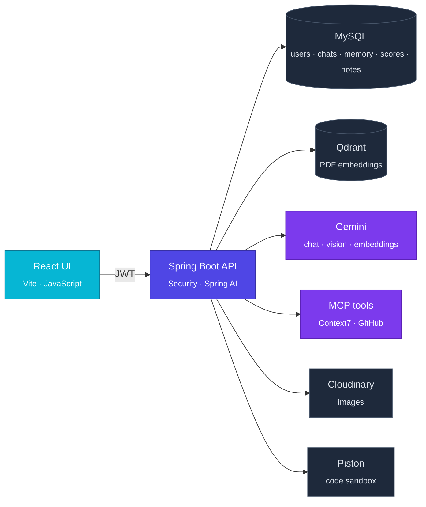

<div align="center">



<sub>An AI programming tutor agent for developers and learners, built with Spring Boot, Spring AI and React.</sub>

<br/><br/>


<sub><a href="#overview">Overview</a> · <a href="#features">Features</a> · <a href="#how-it-works">How it works</a> · <a href="#the-learning-loop">Learning loop</a> · <a href="#getting-started">Getting started</a> · <a href="#api">API</a> · <a href="#roadmap">Roadmap</a></sub>

</div>

<br/>

### Overview

Most chatbots hand you an answer. **DevGuide Agent teaches, tests and remembers.** It explains one concept at a time, **runs its code to prove it works**, checks your skills with **challenges graded by hidden tests**, and brings weak concepts back **at the right time**.

<br/>

### Features

<table>
<tr>
<td width="33%" valign="top">📚 <b>Live docs</b><br/><sub>Context7 checks the current library docs</sub></td>
<td width="33%" valign="top">🐙 <b>GitHub</b><br/><sub>Reads any repo, read-only</sub></td>
<td width="33%" valign="top">📄 <b>Your PDFs</b><br/><sub>Answers cite the file and pages</sub></td>
</tr>
<tr>
<td valign="top">🖼️ <b>Screenshots</b><br/><sub>Gemini Vision reads your error</sub></td>
<td valign="top">▶️ <b>Runs code</b><br/><sub>Real output from a Piston sandbox</sub></td>
<td valign="top">🧾 <b>Cheat sheets</b><br/><sub>PDF or DOCX on demand</sub></td>
</tr>
<tr>
<td valign="top">🧪 <b>Prove it</b><br/><sub>Challenges graded by hidden, pre-checked tests</sub></td>
<td valign="top">❓ <b>Quizzes</b><br/><sub>3 questions from your lesson</sub></td>
<td valign="top">🔁 <b>Spaced repetition</b><br/><sub>Weak concepts come back at the right time</sub></td>
</tr>
<tr>
<td valign="top">🧠 <b>Learns about you</b><br/><sub>Notes it writes and reads across chats</sub></td>
<td valign="top">💡 <b>Hint & Dev mode</b><br/><sub>Hints for learners, code first for devs</sub></td>
<td valign="top">↺ <b>Backup model</b><br/><sub>Keeps answering when Gemini is busy</sub></td>
</tr>
</table>

<br/>

### How it works



Each message is checked, enriched with context (chat memory, your PDFs, your scores and the AI's notes about you), then **Gemini decides which tools to call** before it answers.

<details>
<summary><b>Step by step</b></summary>
<br/>

1. The React app sends the message (and an optional image) with the user's JWT, plus `hintMode` or `devMode` if one is on.
2. Spring Security validates the token and role; the service checks the conversation belongs to that user.
3. The system prompt is built from the tutor guide, recent **quiz scores**, the AI's **notes about the learner**, concepts **due for review** (first message only) and the mode rules.
4. `MessageChatMemoryAdvisor` adds the last 20 messages; `QuestionAnswerAdvisor` adds the best-matching chunks from **this conversation's** PDFs only.
5. Gemini answers, calling Context7, GitHub, `runCode`, `createDocument` or `saveLearnerNote` when it needs them. If the main model fails, the backup model answers.
6. Both messages are saved, and the answer is returned with its `sources` (file + pages) and any `documents` it generated.

</details>

<details>
<summary><b>Architecture</b></summary>
<br/>

[](https://gitdiagram.com/ayoub717542/devguide_agent?utm_source=readme&utm_medium=badge)



</details>

<details>
<summary><b>Example request</b></summary>
<br/>

```http
POST /api/chat
conversationId=18&content=Make me a PDF cheat sheet on Java records
```

```jsonc
{
  "role": "ASSISTANT",
  "content": "Here is your cheat sheet. A record is a compact, immutable data carrier…",
  "sources":   [{ "filename": "oop-notes.pdf", "startPage": 7, "endPage": 8 }],   // grounded in your PDF
  "documents": [{ "id": 7, "title": "Java Records", "format": "PDF",
                  "downloadPath": "/api/documents/7/download" }]                // generated by an AI tool
}
```

</details>

<br/>

### The learning loop



Every quiz and challenge saves a score per concept. A weak score brings the concept back **tomorrow**; each perfect score in a row doubles the wait (**2 → 4 → 8 days**), and the tutor offers the review when it's due.

<br/>

### Under the hood

<details>
<summary><b>Design decisions worth knowing</b></summary>
<br/>

| Concern | How it's handled | Where |
|---|---|---|
| **Ownership** | Every resource is reached through its conversation and checked with `findByIdAndCreatedByEmail`. Not even an admin can read someone else's chat or files; others get `404`, not `403`. | `*ServiceImpl`, repositories |
| **RAG isolation** | Each chunk carries `conversationId` and `documentId` metadata; retrieval uses a filter expression so conversations never leak into each other. | `DocumentServiceImpl`, `ChatServiceImpl` |
| **Citations** | Chunks keep the PDF reader's `page_number` / `end_page_number`; `toSources()` deduplicates them into one entry per file and page range. | `ChatServiceImpl.toSources` |
| **Tool context** | `createDocument` and `saveLearnerNote` get the conversation and user through Spring AI's `ToolContext`, never from the model, so files and notes always belong to the right user. | `DocumentTools`, `LearnerNoteTools` |
| **Tool errors** | Gemini only accepts JSON tool results, so a custom `ToolExecutionExceptionProcessor` turns tool failures into a JSON error the model can recover from, instead of a 500, and logs them. | `AiConfig` |
| **Backup model** | A `@Primary` `ChatModel` wraps Gemini: on any error it retries once with `app.ai.fallback-model`, keeping the same prompt, tools and memory, and logs a `WARN`. | `FallbackChatConfig` |
| **Trusted challenges** | A challenge is only saved if the AI's reference solution passes its own hidden tests (2 tries, else `502`). Tests and solution are never returned or added to the chat history. | `QuizServiceImpl`, `ChallengeRunner` |
| **Cheat-proof grading** | Each run gets a random nonce; only the final `RESULT-<nonce> passed/total` line counts, so printing `PASS` can't fake a score. Compile errors and timeouts are reported as such, not as `0/3`. | `ChallengeRunner` |
| **Spaced repetition** | No extra table: review dates are computed from the score history (streak of perfect scores → 1, 2, 4… days, max 64). The code, not the prompt, decides to mention due reviews, and only on a conversation's first message. | `ReviewScheduler`, `ChatServiceImpl` |
| **Strict XHTML** | The PDF renderer parses XML: bare `&` are escaped automatically, and the tool prompt tells the model to escape `<` and `>` in code. | `GeneratedDocumentServiceImpl`, `DocumentTools` |
| **Clean deletes** | Deleting a conversation removes its messages, AI memory, Qdrant chunks, Cloudinary images, PDF records and generated files. | `ConversationServiceImpl` |
| **Errors** | One JSON shape for every error, with Gemini, Qdrant and upload failures mapped to clear status codes. | `GlobalExceptionHandler` |

</details>

<br/>

### Tech stack

| Frontend | Backend | AI & data |
|---|---|---|
| React 19 | Java 25 · Spring Boot 4.1 | Spring AI 2.0 · Google Gemini |
| Vite 8 | Spring Security · OAuth2 resource server (JWT) | Qdrant vector store |
| JavaScript (ES modules) · ESLint | Spring Data JPA · MapStruct · Lombok | MySQL 8 · JDBC chat memory |
| | springdoc OpenAPI (Swagger UI) | MCP client: Context7, GitHub |
| | OpenHTMLtoPDF · docx4j | Cloudinary |
| | | Piston (self-hosted code sandbox) |

<br/>

### Roles & security

Every resource belongs to one user; nobody else can see it, not even an admin.

<details>
<summary><b>Roles table</b></summary>
<br/>

| | USER | ADMIN |
|---|:---:|:---:|
| Register, log in, read own profile | ✓ | ✓ |
| Conversations, chat, PDFs, generated documents | ✓ own | ✓ own |
| Read another user's conversations or files | ✗ | ✗ |
| Manage users (list, edit, delete) | ✗ | ✓ |
| Lesson search, embeddings API | ✗ | ✓ |

<sub>Stateless JWT (HS256, 60 min). Roles come from the token and are enforced per endpoint with <code>@PreAuthorize</code>. Ownership is enforced in the service layer. CORS allows only the origins in <code>CORS_ALLOWED_ORIGINS</code>.</sub>

</details>

<br/>

### Getting started

**You need:** JDK 25, Node.js 20.19+ or 22.12+, MySQL 8, Docker (for Qdrant and Piston), and a [Gemini API key](https://aistudio.google.com/app/apikey).

**1. Qdrant** (gRPC on 6334, dashboard on 6333)

```bash
docker run -d --name devtutor-qdrant --restart unless-stopped \
  -p 6333:6333 -p 6334:6334 qdrant/qdrant
```

**2. Piston** (code sandbox on 2000). Install the Java and Python runtimes once; they are kept in the `piston_data` volume.

```bash
docker run --privileged -v piston_data:/piston -dit -p 2000:2000 --name piston_api \
  --restart unless-stopped -e PISTON_RUN_TIMEOUT=15000 -e PISTON_RUN_CPU_TIME=15000 \
  ghcr.io/engineer-man/piston

curl -X POST localhost:2000/api/v2/packages -H "Content-Type: application/json" -d '{"language":"java","version":"15.0.2"}'
curl -X POST localhost:2000/api/v2/packages -H "Content-Type: application/json" -d '{"language":"python","version":"3.12.0"}'
```

The longer time limit is needed because Java compiles before it runs. Each install can take a few minutes.

**3. Backend** (port 8081). Set the environment variables below first.

```bash
cd DevTutor
./mvnw spring-boot:run
```

**4. Frontend** (port 5173)

```bash
cd DevGuideFrontend
npm install
npm run dev
```

**5. Explore the API** at http://localhost:8081/swagger-ui.html: log in, click **Authorize**, and paste the token.

<details>
<summary><b>Environment variables</b></summary>
<br/>

| Variable | Required | Description |
|---|:---:|---|
| `DB_URL` | ✓ | e.g. `jdbc:mysql://localhost:3306/devtutor` |
| `DB_USERNAME`, `DB_PASSWORD` | ✓ | MySQL credentials |
| `JWT_SECRET` | ✓ | HS256 signing secret, at least 32 characters |
| `GEMINI_API_KEY` | ✓ | Chat, vision and embeddings |
| `CLOUDINARY_CLOUD_NAME`, `CLOUDINARY_API_KEY`, `CLOUDINARY_API_SECRET` | ✓ | Image storage |
| `CONTEXT7_API_KEY` | | Live documentation lookups |
| `GITHUB_PUBLIC_ACCESS_TOKEN` | | GitHub MCP (read-only). All users share it, so use a fine-grained token limited to **public repositories** |
| `GITHUB_CLIENT_ID`, `GITHUB_CLIENT_SECRET` | ✓ | "Login with GitHub". Callback URL: `http://localhost:8081/login/oauth2/code/github` |
| `GITHUB_TOKEN_ENC_PASSWORD`, `GITHUB_TOKEN_ENC_SALT` | ✓ | Encrypt users' GitHub tokens in the database. The salt is hex, e.g. `openssl rand -hex 8` |
| `GOOGLE_CLIENT_ID`, `GOOGLE_CLIENT_SECRET` | ✓ | "Login with Google". Redirect URI: `http://localhost:8081/login/oauth2/code/google` |
| `OAUTH2_REDIRECT_URL` | | Frontend page that gets the JWT after login. Defaults to `http://localhost:5173/oauth/callback` |
| `CORS_ALLOWED_ORIGINS` | | Comma-separated frontend URLs. Defaults to `http://localhost:5173` |
| `PISTON_URL` | | Code sandbox. Defaults to `http://localhost:2000` |
| `PORT` | | Defaults to `8081` |

Token lifetime is set by `jwt.expiration-minutes` (default `60`) in `application.properties`. The models are set there too: `spring.ai.google.genai.chat.model` (main) and `app.ai.fallback-model` (backup).

</details>

<details>
<summary><b>Make yourself an admin</b></summary>
<br/>

New accounts are `USER`. Promote the first admin in MySQL, then log in again:

```sql
UPDATE app_users SET role = 'ADMIN' WHERE email = 'you@example.com';
```

After that, admins can change roles with `PUT /api/users/{id}`.

</details>

<details>
<summary><b>Troubleshooting</b></summary>
<br/>

| Symptom | Cause | Fix |
|---|---|---|
| `Connection refused … localhost:6334` on startup | Qdrant isn't running | `docker start devtutor-qdrant` |
| `503 Document search is unavailable` | Qdrant went down while running | Start Qdrant, then retry |
| `503 AI service is busy` | Gemini rate limit (429) | Wait a moment and retry |
| CORS error in the browser | Frontend URL isn't allowed | Add it to `CORS_ALLOWED_ORIGINS` |
| `McpHttpClientTransportAuthorizationException` on startup | A Context7 or GitHub key is wrong, expired or not set in this terminal / IDE run configuration | Check `CONTEXT7_API_KEY` and `GITHUB_PERSONAL_ACCESS_TOKEN`, then restart |
| `WARN Main model failed …, using fallback …` | The main Gemini model is busy or unavailable | Nothing to do; the backup answered. Change `app.ai.fallback-model` if the backup is retired |
| The tutor says it couldn't run the code | Piston isn't running | `docker start piston_api` |
| `Time limit exceeded` for Java | Piston's default 3 s limit | Recreate the container with the `PISTON_RUN_TIMEOUT` / `PISTON_RUN_CPU_TIME` settings above |
| `502 Could not create a valid challenge` | The AI's reference solution failed its own tests twice | Retry; the reason is logged as `Challenge rejected …` |

</details>

<br/>

### API

All endpoints except `/api/auth/**` need `Authorization: Bearer <token>`. **owner** means the caller must own the conversation; anyone else gets `404`. The full, live list is in Swagger UI.

<details>
<summary><b>All endpoints</b></summary>
<br/>

| Method | Endpoint | Access | Purpose |
|---|---|---|---|
| **Auth** | | | |
| `POST` | `/api/auth/register` | public | Create an account |
| `POST` | `/api/auth/login` | public | Get a JWT |
| `GET` | `/oauth2/authorization/github` | public | Login with GitHub, redirects to the frontend with `#token=…` |
| `GET` | `/oauth2/authorization/google` | public | Login with Google, redirects to the frontend with `#token=…` |
| **Conversations** | | | |
| `POST` | `/api/chat/conversations` | user | Start a conversation |
| `GET` | `/api/chat/conversations` | user | List your conversations, newest first |
| `PATCH` | `/api/chat/conversations/{id}` | owner | Rename (`{"title": "…"}`) |
| `DELETE` | `/api/chat/conversations/{id}` | owner | Delete it with everything it owns |
| **Chat** | | | |
| `POST` | `/api/chat` | owner | Send a message (multipart, optional image, optional `hintMode=true` or `devMode=true`) |
| `GET` | `/api/chat/conversations/{id}/messages` | owner | Message history, oldest first |
| **Quizzes & challenges** | | | |
| `POST` | `/api/chat/conversations/{id}/quiz` | owner | 3-question quiz on the recent lesson |
| `POST` | `/api/chat/conversations/{id}/quiz/result` | owner | Save a score (`{"topic","score","total"}`) |
| `POST` | `/api/chat/conversations/{id}/challenge` | owner | Coding challenge with hidden, verified tests |
| `POST` | `/api/challenges/{id}/submit` | owner | Run your code (`{"code": "…"}`) → `status`, `passed`, `total`, `output` |
| **PDFs (RAG)** | | | |
| `POST` | `/api/documents/upload` | owner | Add a PDF to a conversation |
| `GET` | `/api/documents/uploads?conversationId=` | owner | List a conversation's PDFs |
| `DELETE` | `/api/documents/uploads/{documentId}` | owner | Remove a PDF and its chunks |
| **Generated documents** | | | |
| `GET` | `/api/documents/generated?conversationId=` | owner | List a conversation's PDF/DOCX files |
| `GET` | `/api/documents/{id}/download` | owner | Download a generated file |
| **Users** | | | |
| `GET` | `/api/users/me` | user | Your profile (name, email, role) |
| `GET` | `/api/users/me/progress` | user | Your quiz and challenge scores, newest first |
| `GET` | `/api/users/me/reviews` | user | Next review date per concept, due first |
| `GET` | `/api/users/me/notes` | user | What the AI remembers about you (10 newest notes) |
| `DELETE` | `/api/users/me/notes/{id}` | user | Delete one of your notes |
| `GET` | `/api/users` | admin | List users |
| `PUT` | `/api/users/{id}` | admin | Edit name, email or role |
| `DELETE` | `/api/users/{id}` | admin | Delete a user |
| **Admin tools** | | | |
| `GET` | `/api/lessons/search` | admin | Search the vector store |
| `POST` | `/api/embeddings` | admin | Embed a text |

</details>

<details>
<summary><b>Example: from login to a cited answer</b></summary>
<br/>

```bash
# 1. log in
TOKEN=$(curl -s -X POST localhost:8081/api/auth/login \
  -H "Content-Type: application/json" \
  -d '{"email":"you@example.com","password":"your-password"}' | jq -r .token)

# 2. start a conversation
curl -X POST localhost:8081/api/chat/conversations \
  -H "Authorization: Bearer $TOKEN" -H "Content-Type: application/json" \
  -d '{"title":"Java basics"}'
# → {"id":1,"title":"Java basics","createdAt":"…","createdById":1}

# 3. add your course notes
curl -X POST localhost:8081/api/documents/upload \
  -H "Authorization: Bearer $TOKEN" \
  -F conversationId=1 -F file=@oop-notes.pdf
# → {"documentId":"3f2c…","filename":"oop-notes.pdf","chunksStored":42}

# 4. ask (add -F file=@screenshot.png to attach an image)
curl -X POST localhost:8081/api/chat \
  -H "Authorization: Bearer $TOKEN" \
  -F conversationId=1 -F "content=What is a Java record?"
```

Errors always use one shape:

```json
{ "timestamp": "…", "status": 404, "error": "Not Found", "message": "Conversation not found", "path": "/api/chat" }
```

</details>

<br/>

### Project structure

<details>
<summary><b>Show tree</b></summary>
<br/>

```
DevTutor_AI/
├─ DevTutor/                      Spring Boot backend
│  └─ src/main/java/com/example/DevTutor/
│     ├─ auth/                    register & login
│     ├─ security/                JWT, roles, CORS
│     ├─ controller/              chat, conversations, documents, users, search
│     ├─ service/                 chat (RAG + memory + tools), quizzes & challenges, challenge runner, conversations, PDF ingestion, file generation
│     ├─ tools/                   AI tools: createDocument, runCode, saveLearnerNote
│     ├─ config/                  AI memory, tool errors, backup model, MCP, Cloudinary
│     ├─ entity/ · repository/    JPA model
│     ├─ dto/ · mapper/           API contracts, MapStruct
│     └─ exception/               global error handling
├─ DevGuideFrontend/              React + Vite (JavaScript)
│  └─ src/                        App.jsx, main.jsx, styles
└─ docs/                          README assets
```

</details>

<br/>

### Roadmap

- [x] **Tutor core:** chat memory, RAG with citations, screenshots, PDF/DOCX sheets, MCP docs and GitHub
- [x] **Security:** JWT, USER/ADMIN roles, ownership on every resource
- [x] **Agent tools:** runs code in Piston, writes and reads learner notes, backup model
- [x] **Learning loop:** quizzes, "Prove it" challenges, progress per concept, spaced repetition
- [x] **Modes:** hint mode for learners, dev mode for developers
- [ ] **Frontend:** login & register, chat with image and PDF upload, sources and downloads, admin page
- [x] **Connect GitHub** per user (OAuth), so each learner's own token is used and they can explore their private repos
- [x] **Login with Google**
- [ ] Streaming answers
- [ ] Automated tests

<br/>

<div align="center">
<sub>Built to make learning to code feel like having a patient mentor beside you.</sub>
</div>
