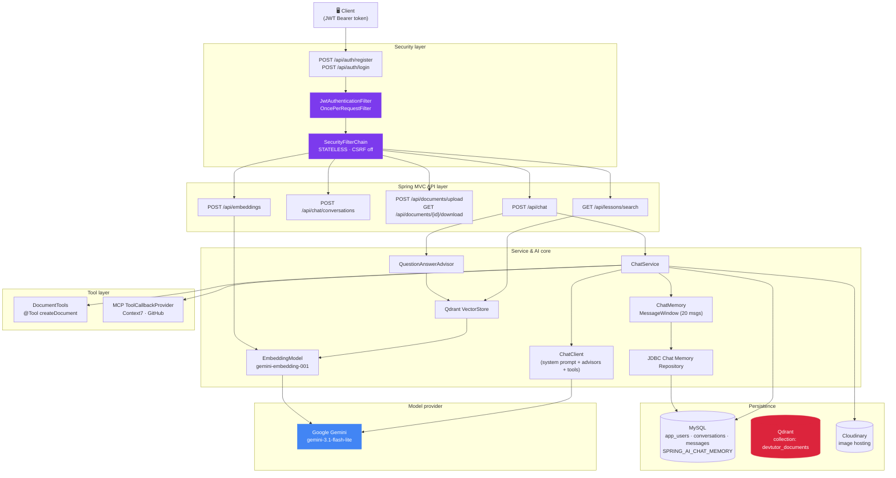
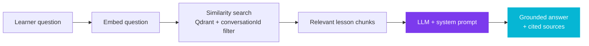
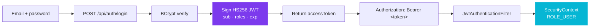

<div align="center">

<!-- ══════════ 3D animated hero ══════════ -->


<!-- ══════════ animated typing tagline ══════════ -->


<br/>

<!-- ══════════ badge strip ══════════ -->
<a href="https://github.com/Ayoub717542/DevGuide-AI"></a>
<a href="https://github.com/Ayoub717542/DevGuide-AI"></a>
<a href="https://github.com/Ayoub717542/DevGuide-AI"></a>
<a href="https://github.com/Ayoub717542/DevGuide-AI"></a>
<a href="https://github.com/Ayoub717542/DevGuide-AI"></a>
<a href="https://github.com/Ayoub717542/DevGuide-AI"></a>

<br/>

<a href="https://github.com/Ayoub717542/DevGuide-AI"></a>
<a href="https://github.com/Ayoub717542/DevGuide-AI"></a>
<a href="https://github.com/Ayoub717542/DevGuide-AI"></a>
<a href="https://github.com/Ayoub717542/DevGuide-AI"></a>
<a href="https://github.com/Ayoub717542/DevGuide-AI"></a>
<a href="https://github.com/Ayoub717542/DevGuide-AI"></a>

<br/>
<br/>

**DevGuide AI** is a backend service that turns a generic LLM into a patient programming mentor.
It teaches, it remembers, it reads your own course material, and it can reach for real tools — all behind a JWT-secured API.

</div>

---

## 📑 Table of contents

| | |
|---|---|
| [💡 What it is](#-what-it-is) | [🧩 Architecture](#-architecture) |
| [🎬 Feature tour](#-feature-tour) | [🛠 Tech stack](#-tech-stack) |
| [🚀 Getting started](#-getting-started) | [🔐 Authentication](#-authentication) |
| [🔌 API reference](#-api-reference) | [📚 How RAG works](#-how-rag-works) |
| [🧠 How memory works](#-how-memory-works) | [🔮 MCP & AI tools](#-mcp--ai-tools) |
| [🧰 Document generation](#-document-generation) | [📁 Project structure](#-project-structure) |

---

## 💡 What it is

Most chatbots are optimised to **answer**. DevGuide AI is built to **teach**.

| Pillar | What it means in practice |
|---|---|
| **Grounded, not hallucinated** | Answers are retrieved from lesson documents you upload — never invented. |
| **One learner, one memory** | Every conversation keeps its own durable history in MySQL. |
| **A personality with a plan** | A dedicated system prompt turns a general model into a mentor that never spoils the exercise. |
| **Real tools** | The tutor can call Context7, GitHub, and generate a styled PDF or Word document mid-answer. |
| **Production-shaped** | Layered service/repository architecture, DTO mapping, JWT security, OpenAPI docs, and a global error contract. |

> 💡 **The teaching contract** lives in `src/main/resources/devtutor-guide.txt`:
> explain simply → small code examples → **one step at a time** → let the student try before revealing the solution.

---

## 🧩 Architecture



<div align="center">

**The RAG loop** — *retrieve the truth, then let the model teach it.*



**The auth loop** — *sign once, stay authenticated.*



</div>

---

## 🎬 Feature tour

<table>
<tr><td width="50%" valign="top">

### 🔐 JWT authentication
Register or log in and receive a signed HS256 token. Every chat, document, and search endpoint requires a valid bearer token.

### 🧑‍🏫 A tutor's brain
A curated system prompt enforces a step-by-step, exercise-first teaching style — and never claims to have read documentation it did not actually retrieve.

### 🧠 Durable memory
Chat history is written to MySQL (`SPRING_AI_CHAT_MEMORY`) so context survives restarts and stays scoped per conversation.

</td><td width="50%" valign="top">

### 📖 Retrieval-augmented answers
Upload your own PDFs, and they are chunked, embedded, and stored in Qdrant. The tutor only answers from chunks belonging to that conversation.

### 🖼️ Vision + media
Attach a PNG/JPEG/WebP screenshot to a question — it is streamed to Gemini and archived in Cloudinary against the message.

### 📄 Document generation
Ask for a styled study sheet and the tutor renders it to **PDF** or **DOCX** and hands back a download link.

</td></tr>
<tr><td width="50%" valign="top">

### 🔮 MCP tools
Two live MCP servers — **Context7** for library documentation and **GitHub** (read-only) for repos, issues, and pull requests — are exposed to the model as callable tools.

### 🔎 Lesson search
Query the vector store directly with natural language and get the most relevant chunks back.

### 🧮 Embeddings API
Expose raw embedding vectors for experimentation and future semantic features.

</td></tr>
</table>

---

## 🛠 Tech stack

| Layer | Choice |
|---|---|
| Language | **Java 25** |
| Framework | **Spring Boot 4.1.1** (Web MVC, Data JPA, Security) |
| Security | **Spring Security 7** — stateless JWT (HS256) via OAuth2 Resource Server (Nimbus) |
| AI framework | **Spring AI 2.0.1** — `ChatClient`, `ChatMemory`, `VectorStore`, `@Tool`, MCP Client |
| Model | **Google Gemini** (`gemini-3.1-flash-lite`) |
| Embeddings | **`gemini-embedding-001`** |
| Vector store | **Qdrant** (collection `devtutor_documents`) |
| Persistence | **MySQL** + Hibernate / JPA |
| Documents | **Apache POI**, **OpenHTMLtoPDF** (PDF), **docx4j** (DOCX) |
| Media | **Cloudinary** (image hosting) |
| Mapping | **MapStruct 1.6.3** + **Lombok** |
| API docs | **springdoc-openapi 3.1.1** (Swagger UI) |
| Build | **Maven** |

<div align="center">


</div>

---

## 🚀 Getting started

### 1. Prerequisites

- ☕ JDK **25+**
- 🐬 A running **MySQL 8** instance
- 🧬 A running **Qdrant** instance (default `localhost:6334`)
- 🔑 A **Google Gemini API key** — [get one](https://aistudio.google.com/app/apikey)

### 2. Configure environment

DevGuide AI reads every secret from environment variables — nothing is hard-coded.

| Variable | Required | Description |
|---|:---:|---|
| `GEMINI_API_KEY` | ✅ | Google Gemini API key (chat **and** embeddings) |
| `DB_URL` | ✅ | JDBC URL, e.g. `jdbc:mysql://localhost:3306/devtutor` |
| `DB_USERNAME` | ✅ | Database user |
| `DB_PASSWORD` | ✅ | Database password |
| `JWT_SECRET` | ✅ | HS256 signing secret (min. 256-bit) |
| `JWT_EXPIRATION` | ➖ | Token lifetime in ms — default `86400000` (24 h) |
| `CLOUDINARY_CLOUD_NAME` | ✅ | Cloudinary cloud name |
| `CLOUDINARY_API_KEY` | ✅ | Cloudinary API key |
| `CLOUDINARY_API_SECRET` | ✅ | Cloudinary API secret |
| `CONTEXT7_API_KEY` | ➖ | Context7 MCP bearer token |
| `GITHUB_PERSONAL_ACCESS_TOKEN` | ➖ | GitHub MCP bearer token (read-only scopes) |
| `PORT` | ➖ | HTTP port — default `8081` |

```properties
# src/main/resources/application.properties
spring.datasource.url=${DB_URL}
spring.datasource.username=${DB_USERNAME}
spring.datasource.password=${DB_PASSWORD}

spring.ai.google.genai.api-key=${GEMINI_API_KEY}
spring.ai.google.genai.chat.model=gemini-3.1-flash-lite
spring.ai.google.genai.embedding.text.model=gemini-embedding-001

spring.ai.vectorstore.qdrant.host=localhost
spring.ai.vectorstore.qdrant.port=6334
spring.ai.vectorstore.qdrant.collection-name=devtutor_documents

app.jwt.secret=${JWT_SECRET}
app.jwt.expiration=${JWT_EXPIRATION:86400000}
```

### 3. Run it

```bash
# from the DevTutor/ directory
./mvnw spring-boot:run
```

The app starts on **http://localhost:8081**, creates the schema (`ddl-auto=update`) and initialises the chat-memory table. Qdrant is populated as soon as you upload your first PDF to a conversation.

### 4. Open the docs

- 📘 Swagger UI → http://localhost:8081/swagger-ui.html
- 🧾 OpenAPI JSON → http://localhost:8081/v3/api-docs

---

## 🔐 Authentication

Every endpoint except `/api/auth/**` and the OpenAPI docs requires a **bearer token**. Tokens are stateless — there is no server-side session to keep alive.

### Register

```bash
curl -X POST http://localhost:8081/api/auth/register \
  -H "Content-Type: application/json" \
  -d '{"name":"Ayoub","email":"ayoub@example.com","password":"S3cret!pass"}'
```

### Log in

```bash
curl -X POST http://localhost:8081/api/auth/login \
  -H "Content-Type: application/json" \
  -d '{"email":"ayoub@example.com","password":"S3cret!pass"}'
```

### Response

```json
{
  "accessToken": "eyJhbGciOiJIUzI1NiJ9....",
  "tokenType": "Bearer",
  "expiresIn": 86400000,
  "user": { "id": 1, "name": "Ayoub", "email": "ayoub@example.com" }
}
```

### Use it

```bash
curl -X POST http://localhost:8081/api/chat \
  -H "Authorization: Bearer $TOKEN" \
  -F "conversationId=1" \
  -F "content=What is an interface?"
```

### How it works

| Component | Responsibility |
|---|---|
| `SecurityConfig` | `SecurityFilterChain` — stateless, CSRF disabled, CORS enabled, `permitAll` on `/api/auth/**` + `/v3/api-docs/**` + `/swagger-ui/**` |
| `JwtEncoder` / `JwtDecoder` | Nimbus HS256 — signs and verifies tokens with `JWT_SECRET` |
| `JwtAuthenticationFilter` | `OncePerRequestFilter` that reads the `Authorization` header and populates the `SecurityContext` |
| `JwtAuthenticationConverter` | Maps the `roles` claim to `ROLE_USER` authorities |
| `PasswordEncoder` | `BCryptPasswordEncoder` — passwords are never stored in plain text |
| `AuthController` | `/api/auth/register`, `/api/auth/login`, `/api/auth/me` |
| `UserDetailsService` | Loads the account from `app_users` by e-mail |

```java
// SecurityConfig.java — stateless, JWT-protected, docs still reachable
@Bean
public SecurityFilterChain filterChain(HttpSecurity http) throws Exception {
    http
        .csrf(AbstractHttpConfigurer::disable)
        .sessionManagement(s -> s.sessionCreationPolicy(SessionCreationPolicy.STATELESS))
        .authorizeHttpRequests(auth -> auth
            .requestMatchers("/api/auth/**", "/v3/api-docs/**", "/swagger-ui/**").permitAll()
            .anyRequest().authenticated())
        .oauth2ResourceServer(o -> o.jwt(Customizer.withDefaults()));
    return http.build();
}
```

> 🧠 **Ownership.** Conversations carry a `created_by` foreign key to `app_users`, so every learner only ever sees the workspaces that belong to them — enforced server-side, never by the client.

---

## 🔌 API reference

| Method | Path | Auth | Purpose |
|---|---|:---:|---|
| `POST` | `/api/auth/register` | ➖ | Create an account, receive a JWT |
| `POST` | `/api/auth/login` | ➖ | Exchange credentials for a JWT |
| `GET` | `/api/auth/me` | ✅ | Current user profile |
| `POST` | `/api/chat` | ✅ | Send a message, get a remembered reply |
| `POST` | `/api/chat/conversations` | ✅ | Create a conversation |
| `POST` | `/api/documents/upload` | ✅ | Upload a PDF to index for RAG |
| `GET` | `/api/documents/{id}/download` | ✅ | Download a generated PDF / DOCX |
| `GET` | `/api/lessons/search` | ✅ | Semantic search over the vector store |
| `POST` | `/api/embeddings` | ✅ | Compute an embedding vector |
| `GET` | `/swagger-ui.html` | ➖ | Interactive API docs |

### Create a conversation

```http
POST /api/chat/conversations
Authorization: Bearer <token>
Content-Type: application/json

{ "title": "Learning inheritance" }
```

```json
{ "id": 1, "title": "Learning inheritance", "createdAt": "2026-04-11T09:31:00", "createdById": 1 }
```

### Send a message

`/api/chat` is a **multipart** endpoint — the optional image rides along with the text.

```bash
curl -X POST http://localhost:8081/api/chat \
  -H "Authorization: Bearer $TOKEN" \
  -F "conversationId=1" \
  -F "content=What is an interface?" \
  -F "file=@screenshot.png"
```

```json
{
  "id": 42,
  "content": "An interface is a contract...",
  "role": "ASSISTANT",
  "createdAt": "2026-04-11T09:32:10",
  "conversationId": 1,
  "sources": [{ "filename": "oop-basics.pdf", "startPage": null, "endPage": null }],
  "imageUrl": "https://res.cloudinary.com/.../upload/v1712...png"
}
```

### Upload a PDF

```bash
curl -X POST http://localhost:8081/api/documents/upload \
  -H "Authorization: Bearer $TOKEN" \
  -F "conversationId=1" \
  -F "file=@lecture-03-inheritance.pdf"
```

```json
{ "documentId": "0f6c1d2e-....", "filename": "lecture-03-inheritance.pdf", "chunksStored": 42 }
```

### Search the vector store

```bash
curl -H "Authorization: Bearer $TOKEN" \
  "http://localhost:8081/api/lessons/search?question=book+class+exercise"
```

### Embed a text

```bash
curl -X POST http://localhost:8081/api/embeddings \
  -H "Authorization: Bearer $TOKEN" \
  -H "Content-Type: application/json" \
  -d '"What is a class?"'
```

### Error contract

Every failure — validation, upstream AI errors, vector-store outages — returns the same shape:

```json
{
  "timestamp": "2026-04-11T09:33:02.481Z",
  "status": 400,
  "error": "Bad Request",
  "message": "Only PDF files are allowed.",
  "path": "/api/documents/upload"
}
```

Handled centrally in `GlobalExceptionHandler` — including Gemini rate limits (`429` → `503`), Qdrant failures (`503`), and oversized uploads (`413`, 10 MB limit).

---

## 📚 How RAG works

1. **Upload** — a PDF arrives at `POST /api/documents/upload` and is validated (PDF only, ≤ 10 MB, conversation must exist).
2. **Extract** — `PagePdfDocumentReader` turns every page into a `Document`.
3. **Chunk** — `TokenTextSplitter` splits the text into passage-sized chunks.
4. **Tag** — each chunk gets `conversationId`, `documentId`, and `filename` metadata.
5. **Embed & store** — chunks are embedded with `gemini-embedding-001` and written to Qdrant.
6. **Retrieve** — `QuestionAnswerAdvisor` runs a similarity search filtered by `conversationId`, so a learner never sees another learner's material.
7. **Augment** — retrieved chunks are injected into the prompt as the ground truth the tutor reasons over.

> 🔒 **Isolation.** The filter expression `conversationId == '<id>'` is applied at query time — cross-conversation leakage is prevented by the store, not by convention.
> 🧩 **Swappable.** Moving from Qdrant to PGVector or Redis is a one-bean change.

---

## 🧠 How memory works

DevGuide AI remembers per conversation, backed by the database — not by process memory.

| Piece | Responsibility |
|---|---|
| `MessageChatMemoryAdvisor` | Injects stored history into each prompt |
| `MessageWindowChatMemory` | Keeps the **last 20** messages in the active window |
| `JdbcChatMemoryRepository` | Persists every turn to `SPRING_AI_CHAT_MEMORY` |
| `conversationId` | Isolates memory so conversations never bleed into each other |

```java
// AiConfig.java — one conversation window, durable in the database
MessageWindowChatMemory.builder()
        .chatMemoryRepository(chatMemoryRepository)
        .maxMessages(20)
        .build();
```

On top of the LLM window, every message is **also** persisted in the `messages` table (`content`, `role`, `created_at`, `conversation_id`, `image_url`), so the full transcript is queryable and the UI can render history after a restart.

---

## 🔮 MCP & AI tools

DevGuide AI speaks the [Model Context Protocol](https://modelcontextprotocol.io) natively — the model decides when to call a tool, and Spring AI executes it.

| MCP server | Transport | Auth | What it exposes |
|---|---|---|---|
| **Context7** | Streamable HTTP → `mcp.context7.com` | `Authorization: Bearer <CONTEXT7_API_KEY>` | Live library documentation — resolve a library, then query its docs for the exact version |
| **GitHub** | Streamable HTTP → `api.githubcopilot.com` | `Authorization: Bearer <GITHUB_PERSONAL_ACCESS_TOKEN>` | Read-only repos, issues, and pull requests (`X-MCP-Readonly: true`) |

Both are registered as Spring AI `ToolCallbackProvider` beans and wired into the `ChatClient` as default tools, so they are available in every conversation without extra configuration.

```java
// Context7Config.java — bearer auth for the Context7 MCP server
@Bean
McpClientCustomizer<HttpClientStreamableHttpTransport.Builder> context7Authentication(
        @Value("${context7.api-key}") String apiKey) {
    return (name, builder) -> {
        if ("context7".equals(name)) {
            builder.requestBuilder(HttpRequest.newBuilder()
                    .header("Authorization", "Bearer " + apiKey));
        }
    };
}
```

> 📚 The system prompt instructs the tutor to **resolve the library first, then query its documentation** — and to state plainly when documentation could not be checked, rather than pretending it did.

---

## 🧰 Document generation

The tutor can answer with a finished document instead of a wall of text. `DocumentTools.createDocument` is a Spring AI `@Tool` that renders the model's XHTML output into a real file.

| Format | Renderer | Download |
|---|---|---|
| **PDF** | OpenHTMLtoPDF (`PdfRendererBuilder`) | `GET /api/documents/{id}/download` |
| **DOCX** | docx4j (`XHTMLImporterImpl` → `WordprocessingMLPackage`) | `GET /api/documents/{id}/download` |

- The model produces **complete valid XHTML with inline CSS** — headings, paragraphs, lists, tables, the requested colour scheme.
- Bytes are stored in the `generated_documents` table (`LONGBLOB`) and streamed back with the correct `Content-Type` and `Content-Disposition`.
- Failures are caught inside the tool and returned to the model as a structured error, so a bad render never breaks the chat.

---

## 📁 Project structure

```text
DevTutor/
├─ src/main/java/com/example/DevTutor/
│  ├─ DevTutorApplication.java        # entry point
│  ├─ config/
│  │  ├─ AiConfig.java                # ChatMemory (durable, 20-message window)
│  │  ├─ SecurityConfig.java          # Spring Security filter chain + JWT
│  │  ├─ CloudinaryConfig.java        # Cloudinary client bean
│  │  ├─ Context7Config.java          # Context7 MCP authentication
│  │  └─ GitHubMcpConfig.java         # GitHub MCP authentication (read-only)
│  ├─ security/
│  │  ├─ JwtService.java              # sign / verify / extract claims
│  │  ├─ JwtAuthenticationFilter.java # OncePerRequestFilter
│  │  └─ RestAuthenticationEntryPoint.java
│  ├─ controller/
│  │  ├─ AuthController.java          # /api/auth/**
│  │  ├─ ChatController.java          # /api/chat
│  │  ├─ DocumentController.java      # /api/documents/upload
│  │  ├─ GeneratedDocumentController.java # /api/documents/{id}/download
│  │  ├─ LessonSearchController.java  # /api/lessons/search
│  │  └─ EmbeddingController.java     # /api/embeddings
│  ├─ service/
│  │  ├─ serviceInterface/            # ChatService · DocumentService · GeneratedDocumentService · AuthService
│  │  └─ serviceImpl/                 # matching implementations
│  ├─ tools/
│  │  └─ DocumentTools.java           # @Tool createDocument (PDF / DOCX)
│  ├─ entity/                         # User · Conversation · Message · GeneratedDocument
│  ├─ dto/                            # request/response payloads
│  ├─ mapper/                         # MapStruct mappers
│  ├─ repository/                     # Spring Data JPA repositories
│  ├─ exception/GlobalExceptionHandler.java
│  ├─ enums/MessageRole.java
│  └─ util/MimeTypes.java
└─ src/main/resources/
   ├─ application.properties          # config (env-var driven)
   ├─ devtutor-guide.txt              # the tutor's system prompt
   └─ schema-chat-memory.sql          # chat memory table
```

---

## 🗺 Roadmap

- [x] Conversational chat with Gemini
- [x] Durable per-conversation memory (JDBC)
- [x] Full RAG loop over uploaded PDFs (Qdrant + `QuestionAnswerAdvisor`)
- [x] Image attachments (Gemini vision + Cloudinary hosting)
- [x] AI-generated PDF / DOCX documents with download endpoint
- [x] MCP client — Context7 documentation lookup
- [x] MCP client — read-only GitHub access
- [x] OpenAPI / Swagger documentation
- [x] Global exception contract
- [x] **JWT authentication with Spring Security** (register, login, protected routes, per-user ownership)
- [ ] Streamed responses (SSE)
- [ ] Refresh-token rotation and revocation list
- [ ] Role-based access (learner / instructor) and shared workspaces
- [ ] Standalone MCP **server** exposing the tutor as first-class tools
- [ ] Vector-store migration to a persistent multi-tenant collection

---

<div align="center">


*Teach, don't tell.*


Built with ☕ Java, 🌱 Spring AI, 🔐 Spring Security, and a genuine desire to make beginners feel capable.

[MIT License](LICENSE) · [Report an issue](https://github.com/Ayoub717542/DevGuide-AI/issues) · [API docs](https://github.com/Ayoub717542/DevGuide-AI)

</div>
