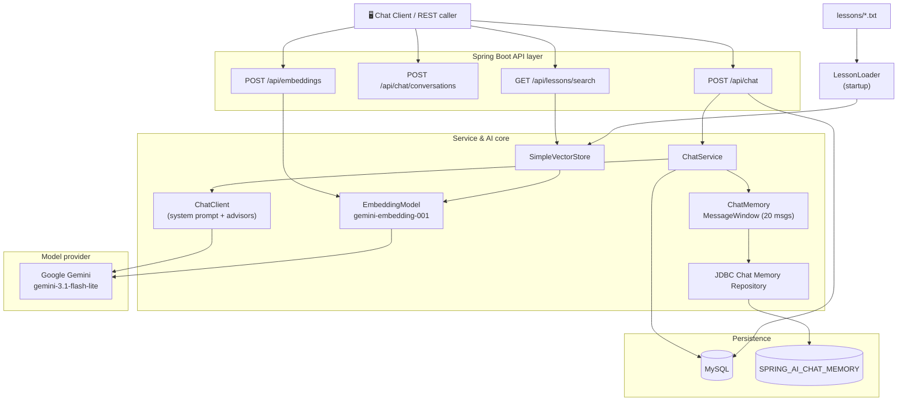
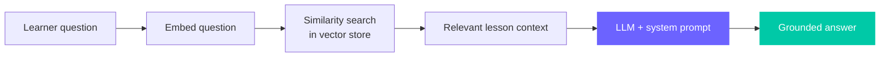

<div align="center">

<!-- Animated waving header -->


<!-- Animated typing tagline -->
[](https://github.com/Ayoub717542/DevTutor_AI)

<!-- Badges -->


**A tutor, not an answer machine.** DevTutor is an AI chatbot that teaches Java to beginners and juniors — it explains step by step, grounds every answer in a real syllabus (RAG), and remembers each learner across the whole conversation.

</div>

---

## 🧭 Table of contents

| | |
|---|---|
| [✨ Why DevTutor](#-why-devtutor) | [🧩 Architecture](#-architecture) |
| [🎬 Feature tour](#-feature-tour) | [🛠 Tech stack](#-tech-stack) |
| [🚀 Getting started](#-getting-started) | [🔌 API reference](#-api-reference) |
| [📚 How RAG works](#-how-rag-works) | [🧠 How memory works](#-how-memory-works) |
| [🔮 MCP integration](#-mcp-integration) | [📁 Project structure](#-project-structure) |

---

## ✨ Why DevTutor

Most chatbots are optimized to *answer*. DevTutor is optimized to **teach**.

- **Grounded, not hallucinated.** Answers about the course are retrieved from real lesson documents instead of being invented.
- **One learner, one memory.** Every conversation keeps its own history, so follow-up questions actually make sense.
- **A personality with a plan.** A dedicated system prompt turns a general model into a patient Java mentor that never spoils the exercise.
- **Production-shaped.** Layered service/repository architecture, DTO mapping, persistent chat memory, and OpenAPI docs out of the box.

> 💡 **The teaching contract** lives in `devtutor-guide.txt`:
> explain in simple English → keep it short → show small code → **one step at a time** → let the student try before revealing the solution.

---

## 🧩 Architecture



<div align="center">

**RAG loop** — *retrieve the truth, then let the model teach it.*



</div>

---

## 🎬 Feature tour

<table>
<tr><td width="50%" valign="top">

### 💬 Conversations
Create a named conversation, then send messages to it. Each one is stored and independently remembered.

### 🗂 Persistent memory
Chat history is written to MySQL (`SPRING_AI_CHAT_MEMORY`) so context survives restarts and scales per conversation.

</td><td width="50%" valign="top">

### 📖 Retrieval-augmented answers
Lessons are loaded from `src/main/resources/lessons` at startup and indexed into a vector store for semantic search.

### 🧑‍🏫 A tutor's brain
A curated system prompt enforces a step-by-step, exercise-first teaching style.

</td></tr>
<tr><td width="50%" valign="top">

### 🔎 Lesson search
Query the syllabus directly with natural language and get the most relevant lesson passages back.

### 🧮 Embeddings API
Expose raw embeddings for experimentation and future semantic features.

</td></tr>
</table>

---

## 🛠 Tech stack

| Layer | Choice |
|---|---|
| Language | **Java 25** |
| Framework | **Spring Boot 4.1.1** (Web MVC, Data JPA) |
| AI framework | **Spring AI 2.0.1** — `ChatClient`, `ChatMemory`, `VectorStore` |
| Model | **Google Gemini** (`gemini-3.1-flash-lite`) |
| Embeddings | **`gemini-embedding-001`** |
| Vector store | `SimpleVectorStore` (in-memory, swappable) |
| Persistence | **MySQL** + Hibernate / JPA |
| Mapping | **MapStruct 1.6.3** + **Lombok** |
| API docs | **springdoc-openapi 3.1.1** (Swagger UI) |
| Build | **Maven** |

---

## 🚀 Getting started

### 1. Prerequisites

- ☕ JDK **25+**
- 🐬 A running **MySQL** instance
- 🔑 A **Google Gemini API key** ([get one](https://aistudio.google.com/app/apikey))

### 2. Configure environment

DevTutor reads its secrets from environment variables (never hard-code them):

| Variable | Description |
|---|---|
| `GEMINI_API_KEY` | Google Gemini API key (chat **and** embeddings) |
| `DB_URL` | JDBC URL, e.g. `jdbc:mysql://localhost:3306/devtutor` |
| `DB_USERNAME` | Database user |
| `DB_PASSWORD` | Database password |
| `PORT` | *(optional)* HTTP port, defaults to `8081` |

```properties
# src/main/resources/application.properties reads these directly
spring.datasource.url=${DB_URL}
spring.datasource.username=${DB_USERNAME}
spring.datasource.password=${DB_PASSWORD}
spring.ai.google.genai.api-key=${GEMINI_API_KEY}
```

### 3. Run it

```bash
# from the DevTutor/ directory
./mvnw spring-boot:run
```

The app starts on **http://localhost:8081**. On startup, `LessonLoader` indexes the lesson files into the vector store.

### 4. Open the docs

- 📘 Swagger UI → http://localhost:8081/swagger-ui.html
- 🧾 OpenAPI JSON → http://localhost:8081/v3/api-docs

---

## 🔌 API reference

### Create a conversation

```http
POST /api/chat/conversations
Content-Type: application/json

{ "title": "Learning inheritance" }
```

```bash
curl -X POST http://localhost:8081/api/chat/conversations \
  -H "Content-Type: application/json" \
  -d '{"title":"Learning inheritance"}'
```

### Send a message

```http
POST /api/chat
Content-Type: application/json

{ "conversationId": 1, "content": "What is an interface?" }
```

```bash
curl -X POST http://localhost:8081/api/chat \
  -H "Content-Type: application/json" \
  -d '{"conversationId":1,"content":"What is an interface?"}'
```

### Search the lessons (RAG)

```bash
curl "http://localhost:8081/api/lessons/search?question=book+class+exercise"
```

### Embed a text

```bash
curl -X POST http://localhost:8081/api/embeddings \
  -H "Content-Type: application/json" \
  -d '"What is a class?"'
```

### Endpoint summary

| Method | Path | Purpose |
|---|---|---|
| `POST` | `/api/chat` | Send a message, get a remembered reply |
| `POST` | `/api/chat/conversations` | Create a conversation |
| `GET` | `/api/lessons/search` | Semantic search over the syllabus |
| `POST` | `/api/embeddings` | Compute an embedding vector |
| `GET` | `/swagger-ui.html` | Interactive API docs |

---

## 📚 How RAG works

1. **Load** — at startup, `LessonLoader` reads `src/main/resources/lessons/*.txt` and wraps it as a `Document`.
2. **Embed** — the `EmbeddingModel` (`gemini-embedding-001`) turns lesson text into vectors.
3. **Store** — vectors land in a `SimpleVectorStore`, the lightweight, swap-in vector store.
4. **Retrieve** — `GET /api/lessons/search` runs a similarity search for a natural-language question.
5. **Augment** — retrieved passages become the ground truth that the tutor reasons over, so answers stay on-syllabus.

> 🔁 Swapping `SimpleVectorStore` for a persistent store (e.g. PGVector, Redis) is a one-bean change in `RagConfig`.

---

## 🧠 How memory works

DevTutor remembers per conversation, backed by the database — not by process memory.

| Piece | Responsibility |
|---|---|
| `MessageChatMemoryAdvisor` | Injects stored history into each prompt |
| `MessageWindowChatMemory` | Keeps the **last 20** messages in the active window |
| `JdbcChatMemoryRepository` | Persists every turn to `SPRING_AI_CHAT_MEMORY` |
| `conversation_id` | Isolates memory so conversations never bleed into each other |

```java
// AiConfig.java — one conversation window, durable in the database
MessageWindowChatMemory.builder()
        .chatMemoryRepository(chatMemoryRepository)
        .maxMessages(20)
        .build();
```

---

## 🔮 MCP integration

DevTutor is designed to be **MCP-ready** — its capabilities map cleanly onto the [Model Context Protocol](https://modelcontextprotocol.io), so an MCP client (Claude Desktop, an IDE agent, or another assistant) can call the tutor as first-class tools.

| Existing capability | Natural MCP surface |
|---|---|
| `GET /api/lessons/search` | **Tool** — `search_lessons(question)` for retrieval |
| Lesson vector store | **Resource** — the syllabus as a readable resource |
| `POST /api/chat` | **Tool** — `ask_tutor(conversationId, content)` |
| Conversations | **Prompts** — reusable teaching templates |

> **Status:** the HTTP surface these tools would wrap is live today. A dedicated MCP server exposing them is the next step on the [roadmap](#-roadmap) — no changes to the core service are required to add it.

---

## 📁 Project structure

```text
DevTutor/
├─ src/main/java/com/example/DevTutor/
│  ├─ DevTutorApplication.java        # entry point
│  ├─ config/
│  │  ├─ AiConfig.java                # ChatClient + durable ChatMemory
│  │  ├─ RagConfig.java               # VectorStore bean
│  │  └─ LessonLoader.java            # indexes lessons on startup
│  ├─ controller/
│  │  ├─ ChatController.java          # /api/chat
│  │  ├─ LessonSearchController.java  # /api/lessons/search
│  │  └─ EmbeddingController.java     # /api/embeddings
│  ├─ service/
│  │  ├─ serviceInterface/ChatService.java
│  │  └─ serviceImpl/ChatServiceImpl.java
│  ├─ entity/                         # User, Conversation, Message
│  ├─ dto/                            # request/response payloads
│  ├─ mapper/                         # MapStruct mappers
│  ├─ repository/                     # Spring Data JPA repositories
│  └─ enums/MessageRole.java
└─ src/main/resources/
   ├─ application.properties          # config (env-var driven)
   ├─ devtutor-guide.txt              # the tutor's system prompt
   ├─ schema-chat-memory.sql          # chat memory table
   └─ lessons/java-basics.txt         # RAG source material
```

---

## 🗺 Roadmap

- [x] Conversational chat with Gemini
- [x] Per-conversation durable memory
- [x] RAG retrieval over lesson documents
- [x] OpenAPI / Swagger documentation
- [ ] Wire retrieved context directly into the chat prompt (full RAG loop)
- [ ] Standalone **MCP server** exposing tutor tools
- [ ] Streamed responses (SSE)
- [ ] Authentication & per-user conversations
- [ ] Persistent vector database for large syllabi

---

<div align="center">

*Teach, don't tell.*


Built with ☕ Java, 🌱 Spring AI, and a genuine desire to make beginners feel capable.

</div>
