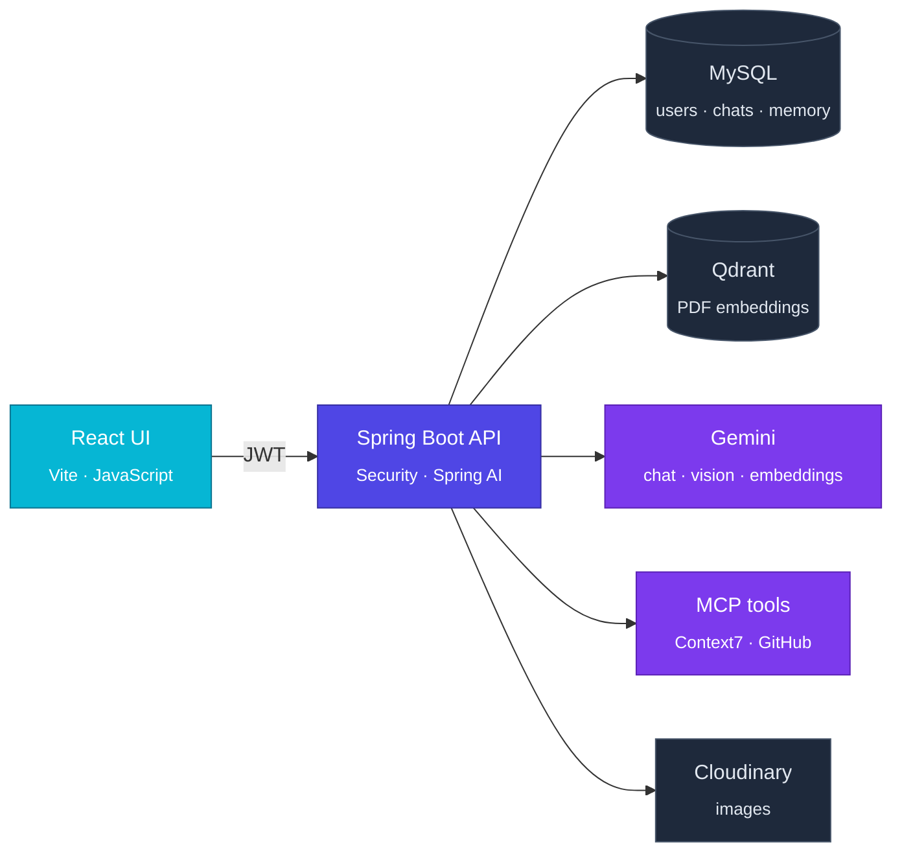

<div align="center">


<sub>An AI programming tutor for learners and developers, built with Spring Boot, Spring AI and React.</sub>

<br/><br/>


<sub><a href="#overview">Overview</a> · <a href="#features">Features</a> · <a href="#architecture">Architecture</a> · <a href="#getting-started">Getting started</a> · <a href="#api">API</a> · <a href="#roadmap">Roadmap</a></sub>

</div>

<br/>

### Overview

Most chatbots hand you an answer. **DevGuide AI teaches.** It explains one concept at a time, uses small code examples, and checks real, current documentation before it answers, so what you learn is correct.

| If you are… | DevGuide AI helps you… |
|---|---|
| **Learning to code** | understand concepts step by step, ask about a screenshot of your error, and study from your own course PDFs |
| **A developer** | get answers grounded in up-to-date library docs (Context7), look through GitHub repos, and export study sheets as PDF or Word |

Every conversation is private to its owner and remembered across restarts, so you can pick up a lesson where you left off.

<br/>

### Features

<table>
<tr>
<td width="50%" valign="top">

**Step-by-step tutor**<br/>
<sub>A teaching prompt keeps answers simple, practical and paced one step at a time.</sub>

**Learns from your PDFs**<br/>
<sub>Upload course notes; answers draw on them, scoped to that conversation only.</sub>

**Remembers the lesson**<br/>
<sub>Chat history is stored in MySQL, per conversation, and survives restarts.</sub>

</td>
<td width="50%" valign="top">

**Live documentation**<br/>
<sub>Looks up current library docs through Context7 and names its sources, or says when it couldn't check.</sub>

**Screenshots welcome**<br/>
<sub>Attach a PNG, JPEG or WebP image; Gemini reads it and Cloudinary stores it.</sub>

**Study sheets**<br/>
<sub>Ask for a summary and download it as a styled PDF or DOCX.</sub>

</td>
</tr>
</table>

<br/>

### Architecture



<details>
<summary><b>How a message flows</b></summary>
<br/>

1. The React app sends the message with the user's JWT.
2. Spring Security checks the token and role; the service checks the conversation belongs to that user.
3. Spring AI adds the conversation's memory (last 20 messages) and the most relevant chunks from that conversation's PDFs.
4. Gemini answers, calling Context7, GitHub or the document generator when it needs them.
5. Both messages are saved, and the answer is returned with its sources.

</details>

<br/>

### Tech stack

| Frontend | Backend | AI & data |
|---|---|---|
| React 19 | Java 25 · Spring Boot 4.1 | Spring AI 2.0 · Google Gemini |
| Vite 8 | Spring Security · OAuth2 resource server (JWT) | Qdrant vector store |
| JavaScript (ES modules) · ESLint | Spring Data JPA · MapStruct · Lombok | MySQL 8 · JDBC chat memory |
| | springdoc OpenAPI (Swagger UI) | MCP client: Context7, GitHub |
| | OpenPDF · docx4j | Cloudinary |

<br/>

### Roles & security

| | USER | ADMIN |
|---|:---:|:---:|
| Register, log in | ✓ | ✓ |
| Create conversations, chat, upload PDFs, download documents | ✓ own | ✓ own |
| Read another user's conversations | ✗ | ✗ |
| Manage users (list, edit, delete) | ✗ | ✓ |
| Lesson search, embeddings API | ✗ | ✓ |

<sub>Stateless JWT (HS256, 60 min). Roles come from the token and are enforced per endpoint with <code>@PreAuthorize</code>. Ownership is enforced in the service layer, so not even an admin can read someone else's conversation.</sub>

<br/>

### Getting started

**You need:** JDK 25, Node.js 20.19+ or 22.12+, MySQL 8, Qdrant on `localhost:6334`, and a [Gemini API key](https://aistudio.google.com/app/apikey).

**1. Backend** (port 8081)

```bash
cd DevTutor
./mvnw spring-boot:run
```

**2. Frontend** (port 5173)

```bash
cd DevGuideFrontend
npm install
npm run dev
```

**3. Explore the API** at http://localhost:8081/swagger-ui.html: log in, click **Authorize**, and paste the token.

<details>
<summary><b>Environment variables</b></summary>
<br/>

| Variable | Required | Description |
|---|:---:|---|
| `DB_URL` | ✓ | e.g. `jdbc:mysql://localhost:3306/devtutor` |
| `DB_USERNAME`, `DB_PASSWORD` | ✓ | MySQL credentials |
| `JWT_SECRET` | ✓ | HS256 signing secret, at least 32 characters |
| `GEMINI_API_KEY` | ✓ | Chat, vision and embeddings |
| `CLOUDINARY_CLOUD_NAME`, `CLOUDINARY_API_KEY`, `CLOUDINARY_API_SECRET` | ✓ | Image storage |
| `CONTEXT7_API_KEY` | | Live documentation lookups |
| `GITHUB_PERSONAL_ACCESS_TOKEN` | | GitHub MCP (read-only) |
| `PORT` | | Defaults to `8081` |

Token lifetime is set by `jwt.expiration-minutes` (default `60`) in `application.properties`.

</details>

<details>
<summary><b>Make yourself an admin</b></summary>
<br/>

New accounts are `USER`. Promote the first admin in MySQL, then log in again:

```sql
UPDATE app_users SET role = 'ADMIN' WHERE email = 'you@example.com';
```

After that, admins can change roles with `PUT /api/users/{id}`.

</details>

<br/>

### API

| Method | Endpoint | Access | Purpose |
|---|---|---|---|
| `POST` | `/api/auth/register` | public | Create an account |
| `POST` | `/api/auth/login` | public | Get a JWT |
| `POST` | `/api/chat/conversations` | user | Start a conversation |
| `POST` | `/api/chat` | owner | Send a message (optional image) |
| `POST` | `/api/documents/upload` | owner | Add a PDF to a conversation |
| `GET` | `/api/documents/{id}/download` | user | Download a generated PDF/DOCX |
| `GET` | `/api/users` | admin | List users |
| `PUT` | `/api/users/{id}` | admin | Edit name, email or role |
| `DELETE` | `/api/users/{id}` | admin | Delete a user |
| `GET` | `/api/lessons/search` | admin | Search the vector store |
| `POST` | `/api/embeddings` | admin | Embed a text |

<details>
<summary><b>Example: log in and ask a question</b></summary>
<br/>

```bash
# 1. log in
curl -X POST localhost:8081/api/auth/login \
  -H "Content-Type: application/json" \
  -d '{"email":"you@example.com","password":"your-password"}'
# → {"token":"eyJ...","tokenType":"Bearer","expiresIn":3600}

# 2. start a conversation
curl -X POST localhost:8081/api/chat/conversations \
  -H "Authorization: Bearer $TOKEN" -H "Content-Type: application/json" \
  -d '{"title":"Java basics"}'

# 3. ask (multipart; add -F file=@screenshot.png to attach an image)
curl -X POST localhost:8081/api/chat \
  -H "Authorization: Bearer $TOKEN" \
  -F conversationId=1 -F "content=What is a Java record?"
```

Errors always use one shape:

```json
{ "timestamp": "…", "status": 404, "error": "Not Found", "message": "Conversation not found", "path": "/api/chat" }
```

</details>

<br/>

### Project structure

<details>
<summary><b>Show tree</b></summary>
<br/>

```
DevTutor_AI/
├─ DevTutor/                      Spring Boot backend
│  └─ src/main/java/com/example/DevTutor/
│     ├─ auth/                    register & login
│     ├─ security/                JWT, roles, security config
│     ├─ controller/              chat, documents, users, search
│     ├─ service/                 chat (RAG + memory + tools), PDF ingestion
│     ├─ tools/                   PDF / DOCX generation tool
│     ├─ config/                  AI memory, MCP, Cloudinary
│     ├─ entity/ · repository/    JPA model
│     ├─ dto/ · mapper/           API contracts, MapStruct
│     └─ exception/               global error handling
├─ DevGuideFrontend/              React + Vite (JavaScript)
│  └─ src/                        App.jsx, main.jsx, styles
└─ docs/                          README assets
```

</details>

<br/>

### Roadmap

- [x] Tutor chat with durable per-conversation memory
- [x] RAG over uploaded PDFs, isolated per conversation
- [x] Image questions, PDF/DOCX study sheets
- [x] MCP tools: Context7 docs, GitHub (read-only)
- [x] JWT auth, USER/ADMIN roles, conversation ownership, admin user management
- [ ] **Frontend:** login & register, chat with image and PDF upload, conversation list, admin users page
- [ ] Connect the React app to the API (Vite dev proxy / CORS)
- [ ] **Connect GitHub** per user (OAuth), so learners can explore their own repos
- [ ] List, rename and delete conversations
- [ ] Streaming answers
- [ ] Automated tests

<br/>

<div align="center">
<sub>Built to make learning to code feel like having a patient mentor beside you.</sub>
</div>
