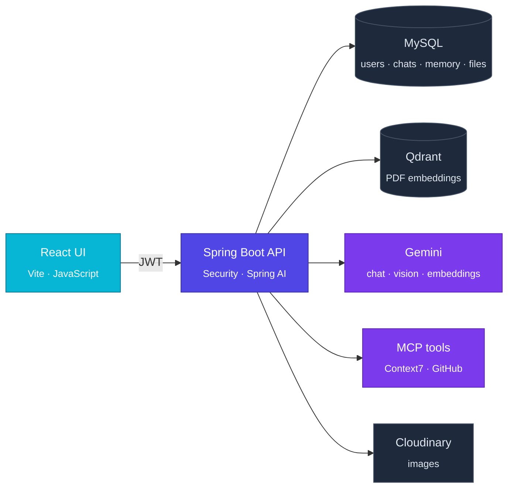

<div align="center">


<sub>An AI programming tutor for developers and learners, built with Spring Boot, Spring AI and React.</sub>

<br/><br/>


<sub><a href="#overview">Overview</a> · <a href="#features">Features</a> · <a href="#architecture">Architecture</a> · <a href="#under-the-hood">Under the hood</a> · <a href="#getting-started">Getting started</a> · <a href="#api">API</a> · <a href="#roadmap">Roadmap</a></sub>

</div>

<br/>

### Overview

Most chatbots hand you an answer. **DevGuide AI teaches**, and it shows its work. It explains one concept at a time with small code examples, checks **current library docs** before answering, reads **your own PDFs and screenshots**, and tells you exactly where each answer came from.

```http
POST /api/chat
conversationId=18&content=Make me a PDF cheat sheet on Java records
```

```jsonc
{
  "role": "ASSISTANT",
  "content": "Here is your cheat sheet. A record is a compact, immutable data carrier…",
  "sources":   [{ "filename": "oop-notes.pdf", "startPage": 7, "endPage": 8 }],   // grounded in your PDF
  "documents": [{ "id": 7, "title": "Java Records", "format": "PDF",
                  "downloadPath": "/api/documents/7/download" }]                // generated by an AI tool
}
```

Every conversation is private to its owner and remembered across restarts, so you can pick up a lesson where you left off.

<br/>

### Features

<table>
<tr>
<td width="50%" valign="top">

**Live documentation (Context7 MCP)**<br/>
<sub>Resolves the library, queries its current docs, names the source, or says plainly when it couldn't check.</sub>

**Read any GitHub repo (GitHub MCP)**<br/>
<sub>Read-only access to explore code, files and issues while you learn.</sub>

**RAG over your PDFs, with citations**<br/>
<sub>Upload course notes; answers cite the file <i>and page range</i>, scoped to that conversation only.</sub>

</td>
<td width="50%" valign="top">

**Debug from a screenshot**<br/>
<sub>Attach a PNG, JPEG or WebP of your error; Gemini Vision reads it, Cloudinary stores it.</sub>

**Cheat sheets on demand**<br/>
<sub>The AI calls a tool that renders styled PDF or DOCX files and returns a download link.</sub>

**Remembers the lesson**<br/>
<sub>Per-conversation memory in MySQL (last 20 messages), full history API, rename and delete.</sub>

</td>
</tr>
</table>

<br/>

### Architecture



<details>
<summary><b>How a message flows</b></summary>
<br/>

1. The React app sends the message (and an optional image) with the user's JWT.
2. Spring Security validates the token and role; the service checks the conversation belongs to that user.
3. `MessageChatMemoryAdvisor` adds the last 20 messages; `QuestionAnswerAdvisor` adds the best-matching chunks from **this conversation's** PDFs only.
4. Gemini answers, calling Context7, GitHub or `createDocument` when it needs them.
5. Both messages are saved, and the answer is returned with its `sources` (file + pages) and any `documents` it generated.

</details>

<br/>

### Under the hood

A few design decisions worth knowing if you read or extend the code:

| Concern | How it's handled | Where |
|---|---|---|
| **Ownership** | Every resource is reached through its conversation and checked with `findByIdAndCreatedByEmail`. Not even an admin can read someone else's chat or files; others get `404`, not `403`. | `*ServiceImpl`, repositories |
| **RAG isolation** | Each chunk carries `conversationId` and `documentId` metadata; retrieval uses a filter expression so conversations never leak into each other. | `DocumentServiceImpl`, `ChatServiceImpl` |
| **Citations** | Chunks keep the PDF reader's `page_number` / `end_page_number`; `toSources()` deduplicates them into one entry per file and page range. | `ChatServiceImpl.toSources` |
| **Tool context** | `createDocument` gets the `conversationId` through Spring AI's `ToolContext`, invisible to the model, so generated files are owned by the right user. | `DocumentTools` |
| **Tool errors** | Gemini only accepts JSON tool results, so a custom `ToolExecutionExceptionProcessor` turns MCP failures into a JSON error the model can recover from, instead of a 500. | `AiConfig` |
| **Strict XHTML** | The PDF renderer parses XML: bare `&` are escaped automatically, and the tool prompt tells the model to escape `<` and `>` in code. | `GeneratedDocumentServiceImpl`, `DocumentTools` |
| **Clean deletes** | Deleting a conversation removes its messages, AI memory, Qdrant chunks, Cloudinary images, PDF records and generated files. | `ConversationServiceImpl` |
| **Errors** | One JSON shape for every error, with Gemini, Qdrant and upload failures mapped to clear status codes. | `GlobalExceptionHandler` |

<br/>

### Tech stack

| Frontend | Backend | AI & data |
|---|---|---|
| React 19 | Java 25 · Spring Boot 4.1 | Spring AI 2.0 · Google Gemini |
| Vite 8 | Spring Security · OAuth2 resource server (JWT) | Qdrant vector store |
| JavaScript (ES modules) · ESLint | Spring Data JPA · MapStruct · Lombok | MySQL 8 · JDBC chat memory |
| | springdoc OpenAPI (Swagger UI) | MCP client: Context7, GitHub |
| | OpenHTMLtoPDF · docx4j | Cloudinary |

<br/>

### Roles & security

| | USER | ADMIN |
|---|:---:|:---:|
| Register, log in, read own profile | ✓ | ✓ |
| Conversations, chat, PDFs, generated documents | ✓ own | ✓ own |
| Read another user's conversations or files | ✗ | ✗ |
| Manage users (list, edit, delete) | ✗ | ✓ |
| Lesson search, embeddings API | ✗ | ✓ |

<sub>Stateless JWT (HS256, 60 min). Roles come from the token and are enforced per endpoint with <code>@PreAuthorize</code>. Ownership is enforced in the service layer. CORS allows only the origins in <code>CORS_ALLOWED_ORIGINS</code>.</sub>

<br/>

### Getting started

**You need:** JDK 25, Node.js 20.19+ or 22.12+, MySQL 8, Docker (for Qdrant), and a [Gemini API key](https://aistudio.google.com/app/apikey).

**1. Qdrant** (gRPC on 6334, dashboard on 6333)

```bash
docker run -d --name devtutor-qdrant --restart unless-stopped \
  -p 6333:6333 -p 6334:6334 qdrant/qdrant
```

**2. Backend** (port 8081). Set the environment variables below first.

```bash
cd DevTutor
./mvnw spring-boot:run
```

**3. Frontend** (port 5173)

```bash
cd DevGuideFrontend
npm install
npm run dev
```

**4. Explore the API** at http://localhost:8081/swagger-ui.html: log in, click **Authorize**, and paste the token.

<details>
<summary><b>Environment variables</b></summary>
<br/>

| Variable | Required | Description |
|---|:---:|---|
| `DB_URL` | ✓ | e.g. `jdbc:mysql://localhost:3306/devtutor` |
| `DB_USERNAME`, `DB_PASSWORD` | ✓ | MySQL credentials |
| `JWT_SECRET` | ✓ | HS256 signing secret, at least 32 characters |
| `GEMINI_API_KEY` | ✓ | Chat, vision and embeddings |
| `CLOUDINARY_CLOUD_NAME`, `CLOUDINARY_API_KEY`, `CLOUDINARY_API_SECRET` | ✓ | Image storage |
| `CONTEXT7_API_KEY` | | Live documentation lookups |
| `GITHUB_PERSONAL_ACCESS_TOKEN` | | GitHub MCP (read-only) |
| `CORS_ALLOWED_ORIGINS` | | Comma-separated frontend URLs. Defaults to `http://localhost:5173` |
| `PORT` | | Defaults to `8081` |

Token lifetime is set by `jwt.expiration-minutes` (default `60`) in `application.properties`.

</details>

<details>
<summary><b>Make yourself an admin</b></summary>
<br/>

New accounts are `USER`. Promote the first admin in MySQL, then log in again:

```sql
UPDATE app_users SET role = 'ADMIN' WHERE email = 'you@example.com';
```

After that, admins can change roles with `PUT /api/users/{id}`.

</details>

<details>
<summary><b>Troubleshooting</b></summary>
<br/>

| Symptom | Cause | Fix |
|---|---|---|
| `Connection refused … localhost:6334` on startup | Qdrant isn't running | `docker start devtutor-qdrant` |
| `503 Document search is unavailable` | Qdrant went down while running | Start Qdrant, then retry |
| `503 AI service is busy` | Gemini rate limit (429) | Wait a moment and retry |
| CORS error in the browser | Frontend URL isn't allowed | Add it to `CORS_ALLOWED_ORIGINS` |

</details>

<br/>

### API

All endpoints except `/api/auth/**` need `Authorization: Bearer <token>`. **owner** means the caller must own the conversation; anyone else gets `404`.

| Method | Endpoint | Access | Purpose |
|---|---|---|---|
| **Auth** | | | |
| `POST` | `/api/auth/register` | public | Create an account |
| `POST` | `/api/auth/login` | public | Get a JWT |
| **Conversations** | | | |
| `POST` | `/api/chat/conversations` | user | Start a conversation |
| `GET` | `/api/chat/conversations` | user | List your conversations, newest first |
| `PATCH` | `/api/chat/conversations/{id}` | owner | Rename (`{"title": "…"}`) |
| `DELETE` | `/api/chat/conversations/{id}` | owner | Delete it with everything it owns |
| **Chat** | | | |
| `POST` | `/api/chat` | owner | Send a message (multipart, optional image) |
| `GET` | `/api/chat/conversations/{id}/messages` | owner | Message history, oldest first |
| **PDFs (RAG)** | | | |
| `POST` | `/api/documents/upload` | owner | Add a PDF to a conversation |
| `GET` | `/api/documents/uploads?conversationId=` | owner | List a conversation's PDFs |
| `DELETE` | `/api/documents/uploads/{documentId}` | owner | Remove a PDF and its chunks |
| **Generated documents** | | | |
| `GET` | `/api/documents/generated?conversationId=` | owner | List a conversation's PDF/DOCX files |
| `GET` | `/api/documents/{id}/download` | owner | Download a generated file |
| **Users** | | | |
| `GET` | `/api/users/me` | user | Your profile (name, email, role) |
| `GET` | `/api/users` | admin | List users |
| `PUT` | `/api/users/{id}` | admin | Edit name, email or role |
| `DELETE` | `/api/users/{id}` | admin | Delete a user |
| **Admin tools** | | | |
| `GET` | `/api/lessons/search` | admin | Search the vector store |
| `POST` | `/api/embeddings` | admin | Embed a text |

<details>
<summary><b>Example: from login to a cited answer</b></summary>
<br/>

```bash
# 1. log in
TOKEN=$(curl -s -X POST localhost:8081/api/auth/login \
  -H "Content-Type: application/json" \
  -d '{"email":"you@example.com","password":"your-password"}' | jq -r .token)

# 2. start a conversation
curl -X POST localhost:8081/api/chat/conversations \
  -H "Authorization: Bearer $TOKEN" -H "Content-Type: application/json" \
  -d '{"title":"Java basics"}'
# → {"id":1,"title":"Java basics","createdAt":"…","createdById":1}

# 3. add your course notes
curl -X POST localhost:8081/api/documents/upload \
  -H "Authorization: Bearer $TOKEN" \
  -F conversationId=1 -F file=@oop-notes.pdf
# → {"documentId":"3f2c…","filename":"oop-notes.pdf","chunksStored":42}

# 4. ask (add -F file=@screenshot.png to attach an image)
curl -X POST localhost:8081/api/chat \
  -H "Authorization: Bearer $TOKEN" \
  -F conversationId=1 -F "content=What is a Java record?"
```

Errors always use one shape:

```json
{ "timestamp": "…", "status": 404, "error": "Not Found", "message": "Conversation not found", "path": "/api/chat" }
```

</details>

<br/>

### Project structure

<details>
<summary><b>Show tree</b></summary>
<br/>

```
DevTutor_AI/
├─ DevTutor/                      Spring Boot backend
│  └─ src/main/java/com/example/DevTutor/
│     ├─ auth/                    register & login
│     ├─ security/                JWT, roles, CORS
│     ├─ controller/              chat, conversations, documents, users, search
│     ├─ service/                 chat (RAG + memory + tools), conversations, PDF ingestion, file generation
│     ├─ tools/                   createDocument tool (PDF / DOCX)
│     ├─ config/                  AI memory, tool errors, MCP, Cloudinary
│     ├─ entity/ · repository/    JPA model
│     ├─ dto/ · mapper/           API contracts, MapStruct
│     └─ exception/               global error handling
├─ DevGuideFrontend/              React + Vite (JavaScript)
│  └─ src/                        App.jsx, main.jsx, styles
└─ docs/                          README assets
```

</details>

<br/>

### Roadmap

- [x] Tutor chat with durable per-conversation memory
- [x] RAG over uploaded PDFs, isolated per conversation, with page citations
- [x] Image questions, AI-generated PDF/DOCX study sheets
- [x] MCP tools: Context7 docs, GitHub (read-only), with recoverable tool errors
- [x] JWT auth, USER/ADMIN roles, ownership on every resource, admin user management
- [x] List, rename and delete conversations; list and remove PDFs; list generated files
- [x] CORS for the React app, `GET /api/users/me`
- [ ] **Frontend:** login & register, chat with image and PDF upload, sources and downloads, admin page
- [ ] **Connect GitHub** per user (OAuth), so learners can explore their own repos
- [ ] Streaming answers
- [ ] Automated tests

<br/>

<div align="center">
<sub>Built to make learning to code feel like having a patient mentor beside you.</sub>
</div>
